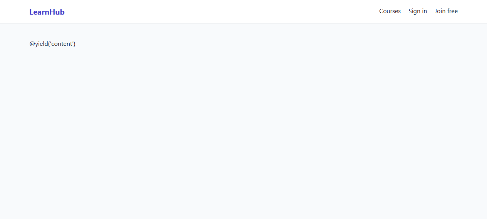
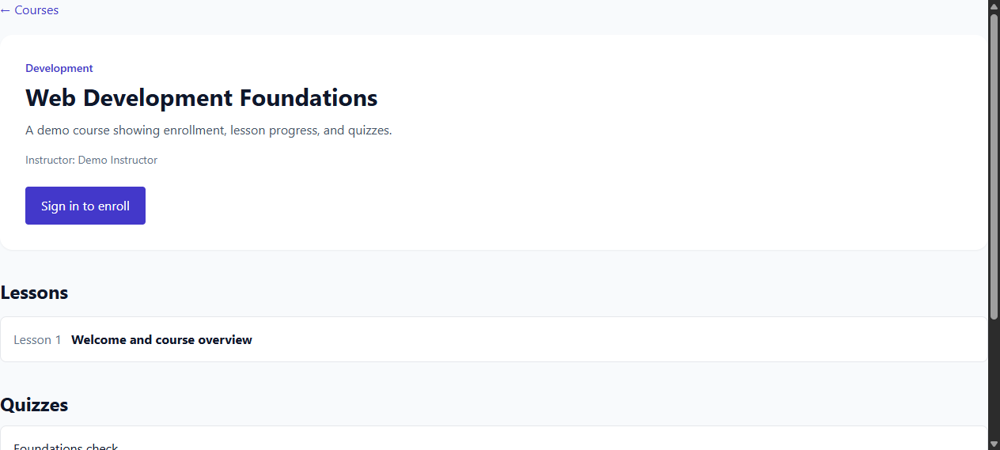
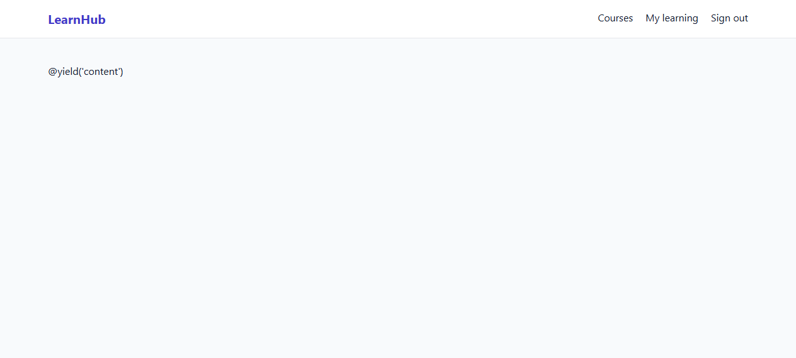
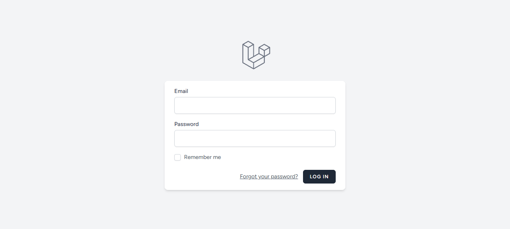

# LMS Laravel

A comprehensive learning management system featuring instructor-managed courses, public course catalogs, student enrollments, progress tracking, lesson viewers, and server-scored quizzes.

Repository: https://github.com/0xyz-exe/lms-laravel

## Screenshots

### Course Catalog & Discovery


### Course Overview & Syllabus


### Student Learning Dashboard


### Lesson Content Viewer


### Interactive Quiz & Self-Assessment


### Authentication


## Features

- **Course Directory & Outlines:** Browse published courses, inspect curriculum modules, instructor bios, and learning objectives.
- **Student Enrollment & Progress:** Students enroll in courses and track lesson completions via structured progress indicators.
- **Enrolled-Only Content Protection:** Lesson viewers and curriculum media are protected by server-side enrollment verification.
- **Interactive Quizzes:** Multiple-choice quiz assessments with instant server-side grading and passing threshold checks.
- **Instructor Authoring Portal:** Instructors create, edit, publish, and manage courses, lessons, and quizzes with ownership validation.

## Setup

- PHP 8.3+, Composer, Node/npm, SQLite or PostgreSQL.
- `composer install`
- Copy `.env.example` to `.env`; configure DB.
- `php artisan key:generate`
- `php artisan migrate --seed`
- `npm ci && npm run build`
- `php artisan serve`
- `php artisan test`

The local seeder creates demo instructor/student accounts and a sample course. Local-only admin seed: `admin@example.test` / `ChangeMe123!`; change immediately, never use in production. Students register with the student role; instructor/admin account provisioning must be performed by an administrator. Instructor CRUD enforces ownership server-side. Quiz answers/scores are validated/calculated on the server.

## Security and limitations

Session authentication uses Laravel Breeze, CSRF protection, role middleware, course ownership checks, and enrollment checks. Do not treat sample accounts as production credentials. Secure cookies/HTTPS, secrets, DB backups, rate limits, and operational monitoring need production configuration. No certificates, course announcements, video hosting, email notification, or production security audit are included. This is a functional learning-workflow slice, not a complete commercial LMS.

## GitHub

Publication pending until tests, commit, and remote verification succeed.

---

<p align="center"><a href="https://laravel.com" target="_blank"></a></p>

<p align="center">
<a href="https://github.com/laravel/framework/actions"></a>
<a href="https://packagist.org/packages/laravel/framework"></a>
<a href="https://packagist.org/packages/laravel/framework"></a>
<a href="https://packagist.org/packages/laravel/framework"></a>
</p>

## About Laravel

Laravel is a web application framework with expressive, elegant syntax. We believe development must be an enjoyable and creative experience to be truly fulfilling. Laravel takes the pain out of development by easing common tasks used in many web projects, such as:

- [Simple, fast routing engine](https://laravel.com/docs/routing).
- [Powerful dependency injection container](https://laravel.com/docs/container).
- Multiple back-ends for [session](https://laravel.com/docs/session) and [cache](https://laravel.com/docs/cache) storage.
- Expressive, intuitive [database ORM](https://laravel.com/docs/eloquent).
- Database agnostic [schema migrations](https://laravel.com/docs/migrations).
- [Robust background job processing](https://laravel.com/docs/queues).
- [Real-time event broadcasting](https://laravel.com/docs/broadcasting).

Laravel is accessible, powerful, and provides tools required for large, robust applications.

## Learning Laravel

Laravel has the most extensive and thorough [documentation](https://laravel.com/docs) and video tutorial library of all modern web application frameworks, making it a breeze to get started with the framework.

In addition, [Laracasts](https://laracasts.com) contains thousands of video tutorials on a range of topics including Laravel, modern PHP, unit testing, and JavaScript. Boost your skills by digging into our comprehensive video library.

You can also watch bite-sized lessons with real-world projects on [Laravel Learn](https://laravel.com/learn), where you will be guided through building a Laravel application from scratch while learning PHP fundamentals.

## Agentic Development

Laravel's predictable structure and conventions make it ideal for AI coding agents like Claude Code, Cursor, and GitHub Copilot. Install [Laravel Boost](https://laravel.com/docs/ai) to supercharge your AI workflow:

```bash
composer require laravel/boost --dev

php artisan boost:install
```

Boost provides your agent 15+ tools and skills that help agents build Laravel applications while following best practices.

## Contributing

Thank you for considering contributing to the Laravel framework! The contribution guide can be found in the [Laravel documentation](https://laravel.com/docs/contributions).

## Code of Conduct

In order to ensure that the Laravel community is welcoming to all, please review and abide by the [Code of Conduct](https://laravel.com/docs/contributions#code-of-conduct).

## Security Vulnerabilities

If you discover a security vulnerability within Laravel, please send an e-mail to Taylor Otwell via [taylor@laravel.com](mailto:taylor@laravel.com). All security vulnerabilities will be promptly addressed.

## License

The Laravel framework is open-sourced software licensed under the [MIT license](https://opensource.org/licenses/MIT).
